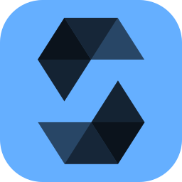
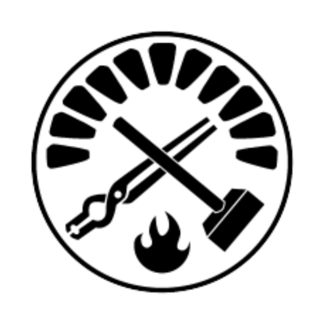

<picture>
  <source media="(prefers-color-scheme: dark)" srcset="https://capsule-render.vercel.app/api?type=rect&color=0:0d1117%2C100:161b22&height=150&section=header&text=Kristian&fontSize=56&fontColor=c9d1d9&fontAlignY=50&desc=financial%20systems%20developer&descSize=15&descAlignY=76&descColor=58A6FF" />
  
</picture>

<picture>
  <source media="(prefers-color-scheme: dark)" srcset="https://readme-typing-svg.demolab.com?font=JetBrains+Mono&size=17&duration=3200&pause=1200&color=58A6FF&center=true&vCenter=true&width=760&height=40&lines=Finance+systems+%C2%B7+Automation;Financial+reporting+%C2%B7+Accounting+integrations;Auditable+financial+infrastructure%2C+on-chain+and+off" />
  
</picture>

## Finance systems and automation, grounded in accounting

I'm Marc Pios, also known as Kristian, a financial systems developer. I combine fractional finance management and bank general-ledger experience with hands-on development, building rules-based workflows for accounting integrations and financial reporting.

My work includes n8n automation, TypeScript applications, and Solidity projects. In accounting workflows, I use defined business rules and management approval before posting to the books. I hold the Certified Forensic Accountant (CrFA) and Certified Financial Consultant (CFC) credentials, and a BS in Management Accounting from the University of Santo Tomas.

<table>
  <tr>
    <td width="160"><b>Focus</b></td>
    <td>Finance systems, workflow automation, financial reporting, accounting integrations</td>
  </tr>
  <tr>
    <td><b>Credentials</b></td>
    <td>CrFA · CFC · BS Management Accounting</td>
  </tr>
  <tr>
    <td><b>Core stack</b></td>
    <td>n8n, Xero, QuickBooks, Oracle GL · TypeScript, Node.js, Next.js, React · Python, PostgreSQL · Solidity, Foundry</td>
  </tr>
  <tr>
    <td><b>Background</b></td>
    <td>Fractional finance management · Bank financial reporting and general-ledger support</td>
  </tr>
  <tr>
    <td><b>Contact</b></td>
    <td><a href="https://x.com/0xKristianity">X</a> · <a href="https://t.me/thisiskristian">Telegram</a> · <a href="https://discord.com/users/iamkristian">Discord</a></td>
  </tr>
</table>

## Finance experience

- **Finance Manager, fractional | Family-Owned Business Group** (Dec 2019 - present): financial planning, reporting, cash flow, and automation for two businesses in trading and agriculture. Cross-department automation enabled one person to handle the work and avoided 1-3 planned additional hires.
- **Financial Reporting Analyst II, Assistant Manager | Citibank N.A., ROHQ** (Oct 2018 - Dec 2019): automation and process improvements reduced staff-hours for the affected work by 33%; also supported bank general-ledger systems, including Oracle GL.
- **Financial Reporting Analyst I, Officer | Citibank N.A., ROHQ** (Jul 2016 - Oct 2018): investigated general-ledger breaks and suspense-account cases and supported system users.
- **Marketing Assistant II | China Banking Corporation** (Jun 2014 - Jun 2016): prepared client recommendations and reports using market research, financial analysis, and due diligence.

## Selected work

Projects are presented separately from employment. The repository descriptions and status notes below are drawn from their READMEs.

**[n8n Workflow Library](https://n8n.io/creators/kristian/)**: accounting workflow examples include routing Telegram quote requests to Xero and disbursement requests to Trello.

**[Discord to n8n Bridge](https://github.com/kristianism/discord-n8n-bridge)**: a TypeScript service that sends normalized Discord create and edit events to an n8n webhook. It supports idempotency keys, bounded delivery, retries, and guild and channel allowlists. The repository documents the service and its deployment configuration.

<table>
  <tr>
    <td width="50%" valign="top">
      <h3><a href="https://github.com/kristianism/zero-balance-sweep-module">Zero-Balance Corporate Sweep Module</a></h3>
      
<code>Solidity 0.8.24</code> <code>Foundry</code> <code>Safe</code> <code>Aave V3</code>

      
A Safe module that sweeps idle ERC-20 operating balances above a threshold into Aave V3 and withdraws exact shortfalls just in time for planned payments.

      <ul>
        <li>Relayer JIT withdrawals require a Safe-set, amount-bound, expiring intent. Relayers can top up the Safe but never execute payments.</li>
        <li>Per-call sweep caps, JIT caps, and a shared relayer cooldown. Validates aToken wiring and Pool reserve registration. No <code>delegatecall</code>.</li>
        <li>Unit, fuzz, invariant, Ethereum mainnet-fork, and Safe v1.4.1 proxy integration tests.</li>
      </ul>
      
<b>Status:</b> reference implementation with an internal security review. No independent professional audit.

    </td>
    <td width="50%" valign="top">
      <h3><a href="https://github.com/kristianism/the-factory">The Factory</a></h3>
      
<code>Solidity 0.8.36</code> <code>Foundry</code> <code>OpenZeppelin 5</code>

      
A smart contract toolkit of small, readable templates created as minimal proxy clones from paused-by-default factories: ERC-20 (standard and tax), ERC-721, vesting wallets, registration and Merkle airdrops, and staking reward farms.

      <ul>
        <li>Two-step ownership acceptance across factories and clones, ERC-2612 permit on the ERC-20, and an owner-controlled UUPS fee collector.</li>
        <li>Documented security review with twelve findings patched and each tied to a named regression test, including reward-as-principal drains, taxed-deposit liabilities, and donation dilution.</li>
      </ul>
      
<b>Status:</b> contract repository, not a finished product. Manual review plus Foundry regression and fuzz tests; not an independent audit. No deployment of the patched release has been performed.

    </td>
  </tr>
</table>

## What I work on

<table>
  <tr>
    <td width="220" valign="top"><b>Finance &amp; reporting</b></td>
    <td>Financial reporting, budgeting, cash flow, and general-ledger support, informed by finance management and banking experience.</td>
  </tr>
  <tr>
    <td valign="top"><b>Accounting &amp; automation</b></td>
    <td>n8n workflows, accounting integrations, reconciliation, and reporting across Xero, QuickBooks, and other systems.</td>
  </tr>
  <tr>
    <td valign="top"><b>Smart contracts &amp; security</b></td>
    <td>Solidity projects, Safe modules, threat modeling, and smart contract review.</td>
  </tr>
  <tr>
    <td valign="top"><b>Full-stack delivery</b></td>
    <td>Next.js and React interfaces, TypeScript and Node.js services, and API integrations.</td>
  </tr>
</table>

## Stack

<table>
  <tr>
    <td width="220" valign="top"><b>Smart contracts</b></td>
    <td>
      &nbsp;
      &nbsp;
      
       Solidity · Foundry · Hardhat
    </td>
  </tr>
  <tr>
    <td valign="top"><b>Languages</b></td>
    <td>
      &nbsp;
      &nbsp;
      &nbsp;
      
       TypeScript · JavaScript · Python · CSS
    </td>
  </tr>
  <tr>
    <td valign="top"><b>Full-stack</b></td>
    <td>
      &nbsp;
      &nbsp;
      &nbsp;
      
       Next.js · React · Tailwind CSS · Node.js
    </td>
  </tr>
  <tr>
    <td valign="top"><b>Automation &amp; data</b></td>
    <td>
      
      
      
      
       n8n · PostgreSQL · Xero · QuickBooks
    </td>
  </tr>
  <tr>
    <td valign="top"><b>Tooling</b></td>
    <td>
      &nbsp;
      &nbsp;
      
       Visual Studio Code · Docker · Raspberry Pi
    </td>
  </tr>
</table>

## Operating principles

<table>
  <tr>
    <td width="280" valign="top"><code>01</code> <b>Correctness over cleverness</b></td>
    <td>Testable business rules, explicit financial calculations, and pinned dependencies where appropriate.</td>
  </tr>
  <tr>
    <td valign="top"><code>02</code> <b>Audit trails by default</b></td>
    <td>Records, events, and structured logs that support review and reconciliation while protecting sensitive information.</td>
  </tr>
  <tr>
    <td valign="top"><code>03</code> <b>Threat model first</b></td>
    <td>Identify trust boundaries and each actor's authority before implementing financial or contract logic.</td>
  </tr>
  <tr>
    <td valign="top"><code>04</code> <b>Composable over bespoke</b></td>
    <td>Use focused components and integrations that fit the systems and controls already in place.</td>
  </tr>
  <tr>
    <td valign="top"><code>05</code> <b>Measure what ships</b></td>
    <td>Choose tests for the system's risks and document their limits, including workflow checks and contract fuzz and fork tests.</td>
  </tr>
</table>

## Activity

<picture>
  <source media="(prefers-color-scheme: dark)" srcset="https://streak-stats.demolab.com/?user=kristianism&theme=github-dark-blue&hide_border=true&date_format=M%20j%5B%2C%20Y%5D&ring=58A6FF&fire=58A6FF&currStreakLabel=58A6FF" />
  
</picture>

## Contact

For finance systems, accounting automation, or software projects, connect through the website or LinkedIn.

&nbsp;&nbsp;&nbsp;&nbsp;

