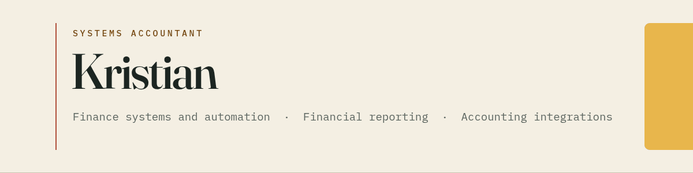

  

## Finance systems, grounded in accounting

I'm Marc Pios, also known as Kristian. I'm a Systems Accountant: fractional finance management and bank general-ledger work, plus the software that removes the manual steps around them.

Automation only earns its place when it stays auditable. In practice: defined business rules, a named approver, a written record of what changed, and a ledger that still balances after the run. When a coding agent drafts part of a workflow, the accounting rules and the approval step are written down and checked by a person.

<table>
  <tr>
    <td width="160"><b>Focus</b></td>
    <td>Finance systems, workflow automation, financial reporting, accounting integrations</td>
  </tr>
  <tr>
    <td><b>Credentials</b></td>
    <td>CrFA · CFC · L2 Xero Certified Professional · QuickBooks Online Certified ProAdvisor · BS Management Accounting</td>
  </tr>
  <tr>
    <td><b>Core stack</b></td>
    <td>n8n, Xero, QuickBooks, Oracle GL · TypeScript, Node.js, Next.js, React · Python, PostgreSQL</td>
  </tr>
  <tr>
    <td><b>Background</b></td>
    <td>Fractional finance management · Bank financial reporting and general-ledger support</td>
  </tr>
  <tr>
    <td><b>Portfolio</b></td>
    <td><a href="https://www.marcpios.com">marcpios.com</a> · <a href="https://www.marcpios.com/work/odoo-intake-pipeline">receipt-to-ledger case study</a></td>
  </tr>
  <tr>
    <td><b>Contact</b></td>
    <td><a href="https://x.com/0xKristianity">X</a> · <a href="https://t.me/thisiskristian">Telegram</a> · <a href="https://discord.com/users/iamkristian">Discord</a></td>
  </tr>
</table>

## What I build

<table>
  <tr>
    <td width="220" valign="top"><b>Financial operations</b></td>
    <td>Financial reporting, budgeting, forecasting, cash-flow and working-capital management, and cost analysis, informed by finance management and bank general-ledger experience.</td>
  </tr>
  <tr>
    <td valign="top"><b>Workflow automation</b></td>
    <td>Custom n8n workflows that automate data pipelines, API integrations, and repetitive work across financial systems.</td>
  </tr>
  <tr>
    <td valign="top"><b>Accounting &amp; ERP</b></td>
    <td>Bank general-ledger support and cloud accounting across chart-of-accounts configuration, reconciliation workflows, and financial reporting.</td>
  </tr>
  <tr>
    <td valign="top"><b>Reporting &amp; integration</b></td>
    <td>Connecting reporting and operational workflows with reporting tools, API integrations, and structured data transformations.</td>
  </tr>
  <tr>
    <td valign="top"><b>AI agents, bounded</b></td>
    <td>Coding agents used to draft, refactor, and test the automation I build, with the accounting rules and approval steps written down and checked by a person.</td>
  </tr>
</table>

## Selected work

Employment facts and project evidence are kept separate. Each project links to the repository that documents it.

**[marcpios.com](https://www.marcpios.com)**: the portfolio itself, a six-page ledger built with Next.js and TypeScript. Typography, motion, and the receipt-to-ledger story are authored, not themed; the site ships its own tests for routing, structured data, accessibility, and discovery.

**[Receipt to ledger](https://www.marcpios.com/work/odoo-intake-pipeline)**: a case study of an intake pipeline where AI proposes fields from a receipt, deterministic rules do the arithmetic, and posting stays a human step. Untagged captures are dropped and verified rows are never rewritten.

**[n8n Workflow Library](https://n8n.io/creators/kristian/)**: accounting workflow examples, including routing Telegram quote requests to Xero and disbursement requests to Trello.

**[Discord to n8n Bridge](https://github.com/kristianism/discord-n8n-bridge)**: a TypeScript service that holds a Discord Gateway connection, normalizes new and edited messages into a stable JSON envelope, and delivers them to an n8n webhook with idempotency keys, bounded delivery, retries, and guild and channel allowlists.

## Finance experience

- **Finance Manager, fractional | Family-Owned Business Group** (Dec 2019 - present): financial planning, reporting, cash flow, and automation for two businesses in trading and agriculture. Cross-department automation enabled one person to handle the work and avoided 2 planned additional hires.
- **Financial Reporting Analyst II, Assistant Manager | Citibank N.A., ROHQ** (Oct 2018 - Dec 2019): automation and process improvements reduced staff-hours for the affected work by 33%; also supported bank general-ledger systems, including Oracle GL.
- **Financial Reporting Analyst I, Officer | Citibank N.A., ROHQ** (Jul 2016 - Oct 2018): investigated general-ledger breaks and suspense-account cases and supported system users.
- **Marketing Assistant II | China Banking Corporation** (Jun 2014 - Jun 2016): prepared client recommendations and reports using market research, financial analysis, and due diligence.

## How I work

<table>
  <tr>
    <td width="220" valign="top"><code>01</code> <b>Correctness</b></td>
    <td>Double-entry discipline applied to code: every state change should balance, and every rule should be testable.</td>
  </tr>
  <tr>
    <td valign="top"><code>02</code> <b>Audit trails</b></td>
    <td>Systems should explain themselves: events, logs, and records that survive scrutiny long after the transaction.</td>
  </tr>
  <tr>
    <td valign="top"><code>03</code> <b>Threat modeling</b></td>
    <td>Assume adversarial inputs. Identify who can call what, with which funds, before the logic is written.</td>
  </tr>
  <tr>
    <td valign="top"><code>04</code> <b>Composability</b></td>
    <td>Small, well-defined modules that integrate cleanly with the platforms finance teams already run.</td>
  </tr>
</table>

## Stack

<table>
  <tr>
    <td width="220" valign="top"><b>Languages</b></td>
    <td>
      &nbsp;
      &nbsp;
      &nbsp;
      
       TypeScript · JavaScript · Python · CSS
    </td>
  </tr>
  <tr>
    <td valign="top"><b>Full-stack</b></td>
    <td>
      &nbsp;
      &nbsp;
      &nbsp;
      
       Next.js · React · Tailwind CSS · Node.js
    </td>
  </tr>
  <tr>
    <td valign="top"><b>Accounting &amp; data</b></td>
    <td>
      
      
      
      
      
       n8n · Xero · QuickBooks · Oracle GL · PostgreSQL
    </td>
  </tr>
  <tr>
    <td valign="top"><b>Tooling</b></td>
    <td>
      &nbsp;
      &nbsp;
      
       Visual Studio Code · Docker · Raspberry Pi
    </td>
  </tr>
</table>

## Activity

<picture>
  <source media="(prefers-color-scheme: dark)" srcset="https://streak-stats.demolab.com/?user=kristianism&theme=github-dark-blue&hide_border=true&date_format=M%20j%5B%2C%20Y%5D&ring=E8B64C&fire=B0503C&currStreakLabel=E8B64C" />
  
</picture>

## Contact

For finance systems, accounting automation, or software work, the fastest route is the portfolio site: <a href="https://www.marcpios.com">marcpios.com</a>.

&nbsp;&nbsp;&nbsp;&nbsp;

